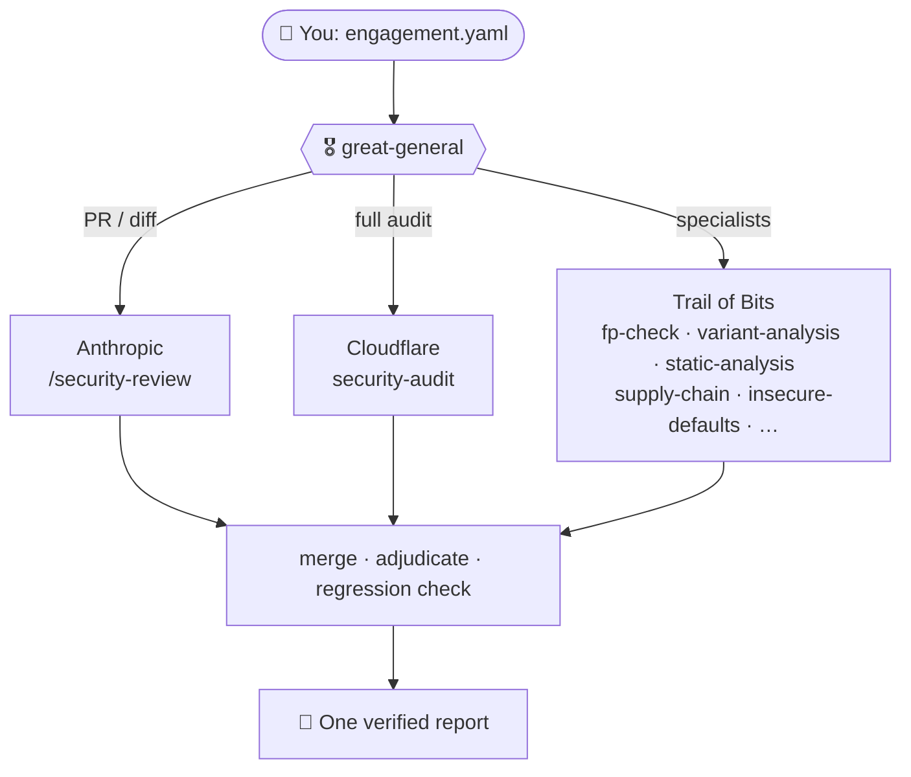
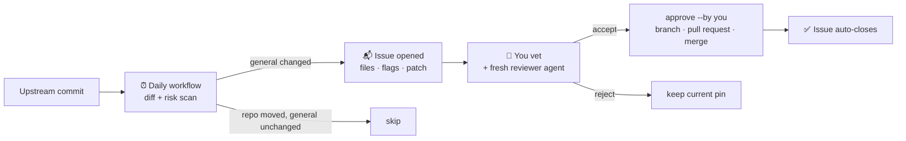

<div align="center">

# 🎖️ great-general

**One commander for your security reviews. It deploys the best public security skills, merges what they find into one verified report, and vets every one of them before they're trusted.**

[](LICENSE)


[](https://github.com/TahrimWalid/great-general/actions/workflows/watch-generals.yml)

</div>

---

Anthropic, Cloudflare and Trail of Bits each publish excellent security skills, and each keeps improving them. **great-general** doesn't try to replace them. It **commands** them:

- 📜 **Rules of engagement:** what may be reviewed, touched and proven, and what never may.
- 🗺️ **Deployment:** which general fights which battle, each in its own fresh context.
- 📋 **After-action report:** merges duplicates across generals, settles disagreements, and flags regressions since your last review.
- 🔍 **Vetting the generals:** every general is pinned to a commit and hashed; no update lands until **you** have read what changed.



## 🪖 The generals

| General | Provider | Use it for |
|---|---|---|
| `anthropic-security-review` | Anthropic | Fast, high-confidence review of a PR or pending changes |
| `cloudflare-security-audit` | Cloudflare | Full six-phase audit: recon, coverage ledger, hunters per bug class, disproving verifiers |
| `tob-audit-context-building` | Trail of Bits | Deep context before hunting in unfamiliar code |
| `tob-static-analysis` | Trail of Bits | CodeQL and Semgrep, SARIF output |
| `tob-insecure-defaults` | Trail of Bits | Fail-open settings, default credentials, debug features |
| `tob-supply-chain-risk-auditor` | Trail of Bits | Dependencies, lockfiles, install scripts |
| `tob-agentic-actions-auditor` | Trail of Bits | GitHub Actions that run AI agents |
| `tob-differential-review` | Trail of Bits | Security review of a diff with blast radius |
| `tob-sharp-edges` | Trail of Bits | Error-prone APIs and dangerous config designs |
| `tob-fp-check` | Trail of Bits | Is this one finding real? True/false positive with evidence |
| `tob-variant-analysis` | Trail of Bits | Found one bug? Find all its siblings |
| `claude-security` | Anthropic (Enterprise) | Managed scans; import the exported findings |

Generals are **not copied into this repo**. They're fetched from their upstreams at the exact commits pinned in [`generals.lock.json`](generals.lock.json); see [NOTICE.md](NOTICE.md) for their licences.

## 🚀 Quick start

**1. Install**

```bash
git clone https://github.com/TahrimWalid/great-general ~/.claude/skills/great-general
cd ~/.claude/skills/great-general && pip install pyyaml
```

**2. Fetch, vet and approve the generals** (once; about 15 minutes)

```bash
python3 scripts/generals.py fetch                       # exact pinned commits only
python3 scripts/generals.py vet --id cloudflare-security-audit   # repeat per general; read the report
python3 scripts/generals.py approve --id cloudflare-security-audit \
        --commit <sha> --by "Your Name" --note "read the vet report"
```

> 💡 Ask Claude to *"summarise the vet reports as a reviewer"*. It follows [`references/vetting.md`](references/vetting.md) and never approves on its own.

**3. Install the approved generals**

```bash
python3 scripts/generals.py install --all --dest ~/.claude/skills --marketplace ~/.great-general/marketplace
# then in Claude Code:
/plugin marketplace add ~/.great-general/marketplace
```

**4. Write your rules of engagement**: `.great-general/engagement.yaml` in your project:

```yaml
owner: "Your Name"
authorization: "I own this code and authorise this review."
target: {repo: ~/projects/myapp, worktree: ~/myapp_secrev/wt, ref: main}
campaign: full-audit          # pr | full-audit | release | follow-up | re-check
previous_reviews: [~/myapp_review_v1/findings.json]
lab: {never_touch: [my-public-vps]}
poc_policy: {allowed: false}
```

Full template: [`references/engagement.md`](references/engagement.md).

**5. Ask Claude:**

> *"Run a great-general full audit."* · *"Security gate for this PR."* · *"Re-check last month's findings."*

## 🎯 Campaigns

| Campaign | When | Generals deployed |
|---|---|---|
| `pr` | every pull request | security-review, differential-review |
| `full-audit` | first review, or major changes | context-building → Cloudflare audit, static analysis, insecure defaults, supply chain, CI workflows |
| `release` | before shipping | full-audit + extra weight on CI, packaging and defaults |
| `follow-up` | specific suspected bugs | fp-check, variant-analysis |
| `re-check` | after fixes | Cloudflare prior-run carry-forward + fresh verification + regression table |

## 🔔 Staying up to date: the vetting pipeline



- Runs daily from [`.github/workflows/watch-generals.yml`](.github/workflows/watch-generals.yml), or on demand from the Actions tab.
- **Never executes** upstream code; it only fetches it and reads it as text.
- Opens one issue per real update, labelled `general-update`. You're notified as the repo owner.
- Nothing is approved, installed or synced automatically.

## 🧾 What the report gives you

- ✅ **Confirmed** findings with severity, the source trace, the smallest fix, and which generals agreed.
- ❓ **Needs validation** items, each with the exact open question. No guessed severities.
- 🔁 **Regressions:** earlier "fixed" findings that came back, matched even after code moved.
- 🗺️ **Coverage:** what each general reviewed and, just as important, what nothing reviewed.
- 📈 **Trust over time:** each general's precision from your dispositions, so a dip after an update shows up.

## 🛡️ Built-in guardrails

| | |
|---|---|
| 📝 Report only | Never fixes, commits or pushes to the target |
| 🌳 Worktree + external run folder | Your main checkout and repo stay untouched |
| 🚫 Never-touch hosts | Enforced by `engagement.py` and `lab.py` |
| 🧫 Proofs | Off by default; when allowed: lab machines only, snapshot first, minimal, logged |
| 🔐 Unapproved or tampered generals | Refused at deploy and install (`verify` re-hashes every file) |
| 🧠 Prompt injection | Code, docs and generals' output are data, never instructions |

## 🧰 Scripts

| Script | Does |
|---|---|
| `generals.py` | list · fetch · verify · vet · check-updates · diff · approve · install |
| `risk_scan.py` | Flags hooks, code, network, credentials, hidden or bidirectional characters, agent-directed text |
| `engagement.py` | Validates the rules of engagement, opens a run outside the repo |
| `merge_findings.py` | Imports Cloudflare / Anthropic / SARIF / manual findings; merge · validate · compare · trust |
| `watch_generals.py` | The daily upstream watcher behind the workflow |
| `lab.py` | Snapshot and restore lab machines around any proof |

## 🧪 Evals

`evals/` holds 4 cases in the skill-creator format: an audit with a regression to catch, refusing to self-approve, catching a **poisoned general update**, and refusing proofs outside policy.

## ❓ FAQ

<details><summary><b>Why not just fork the upstream repos?</b></summary>

Each general is a slice of a bigger repo, from three different upstreams, and a plain sync pulls changes in unvetted. Pinning by commit, with hashes, gives you exactly what you approved, and the watcher tells you when it's worth looking.
</details>

<details><summary><b>Can it test things it finds by actually exploiting them?</b></summary>

Only if you allow it in `poc_policy`, only to settle an open question, only against your own lab machines (snapshotted first), and only to the minimum needed to show the flaw. Off by default.
</details>

<details><summary><b>How do I add another security skill?</b></summary>

Add it to `generals.lock.json`, then run `fetch`, `vet`, and `approve` it yourself. See [`references/generals.md`](references/generals.md).
</details>

## 🤝 Contributing

Issues and pull requests are welcome. `main` is protected: changes land through pull requests. Found a security problem in great-general itself? Please open a [private security advisory](https://github.com/TahrimWalid/great-general/security/advisories/new) rather than a public issue.

## 📄 License

[MIT](LICENSE) © 2026 Walid Hassan Tahrim. The generals keep their own licences; see [NOTICE.md](NOTICE.md).
